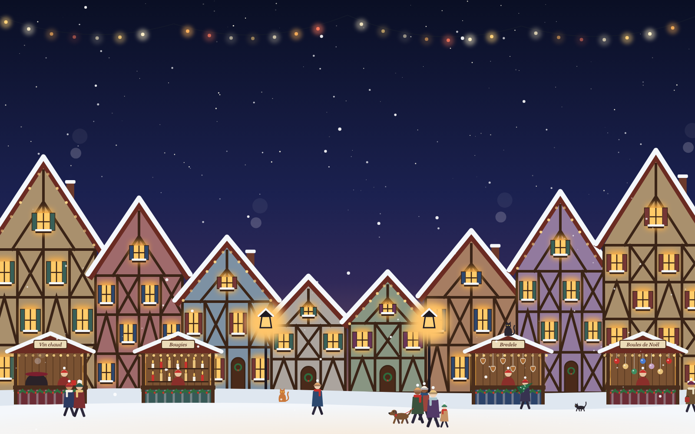
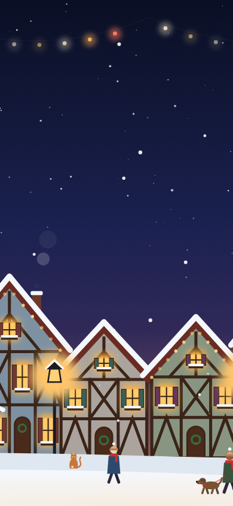

# 🎄 Claude Christmas Village

An animated Christmas backdrop for Claude Code: a snowy Alsatian village on Christmas evening, drawn behind your chat in the Claude desktop and mobile apps.

> **This is an experiment** with Anthropic's theme skill: the plugin-authoring skill in Claude Code, which lets Claude write *mods* that change Claude's own interface. This whole theme was designed and written by Claude through that skill, from a few sentences of description. Mods are an early-access feature, so the API may change between Claude Code releases.



<p align="center"></p>

## What's in the scene

- **Half-timbered houses** (*colombages*) in soft ochre, rose, blue, cream, sage, apricot and mauve, with snow on the roofs, warm glowing windows, shutters, snowy sills and a wreath on every door.
- **A Christmas market** with four wooden booths: *Vin chaud* (a steaming pot of mulled wine), *Bougies* (flickering candles), *Bredele* (gingerbread hearts) and *Boules de Noël* (glass baubles), each with a stallholder, fairy lights and pine garlands.
- **Passers-by** strolling both ways: a couple, a parent with a child, someone carrying a Christmas tree, a shopper, and two people walking their dogs (tails wagging).
- **Cats**: one on a booth roof swishing its tail, a ginger one under a street lamp, and a black one wandering along the street.
- **Evening atmosphere**: an indigo sky with twinkling stars, string lights, glowing street lamps, chimney smoke and three layers of falling snow.
- **Matching colors** for the app itself: dark blue panels with lamplight-amber accents, frosted over the scene so text stays readable.

The houses keep to the edges and the middle of the sky stays clear, so your messages stay readable. If your system asks for reduced motion, the scene pauses.

## Requirements

- **Claude Code** with plugin (mod) support, used through the **Claude desktop app (Code tab)** or the **Claude mobile app**. Those are the surfaces that draw themes and backdrops.
- The terminal and IDE extensions (VS Code, JetBrains) load the plugin but draw no backdrop.
- Regular claude.ai chat conversations don't run plugins.

## Install

At the prompt of a Claude Code terminal session:

```
/plugin install christmas-village --marketplace tonystrawberry/claude-christmas-village
```

Answer `y` to add the marketplace, then pick a scope (the **user** scope makes it apply to every session).

From a shell:

```bash
claude plugin install christmas-village --marketplace tonystrawberry/claude-christmas-village
```

In the desktop app, where `/plugin` does not run: click **+** next to the prompt box, then **Plugins** → **Add marketplace** with `tonystrawberry/claude-christmas-village`, then **Add plugin**.

The theme is applied when a session starts. Open a new Code session in the desktop app to see it.

## Uninstall

```
/plugin uninstall christmas-village
```

or from a shell: `claude plugin uninstall christmas-village`. The app's normal look returns in your next session.

## Customize it

Everything lives in [`hooks/register.tsx`](hooks/register.tsx):

| What | Where |
| --- | --- |
| App colors (panels, text, accent) | the `makeColors({ ... })` block at the top |
| Houses: position, size, wall and shutter colors, chimneys, roof lights | the `HOUSES` list |
| Market booths and their signs | `MARKET_SCENE` and the `booth()` function |
| People, dogs and cats: coats, hats, speed, direction | the `WALKERS` list, plus `catSitting()` |
| Animation speeds (snow, blinking, walking) | the `<style>` block inside `SCENE` |

To try edits locally, run Claude Code with the folder loaded directly:

```bash
claude --plugin-dir ./claude-christmas-village
```

Check your changes with `claude plugin validate .` and type-check with `npx tsc -p .`.

## How it works

The plugin is a single hooks module:

- On `session.start` it calls `$.theme.set(...)` with a color palette (generated by `make-colors.js`, copied unchanged from Claude Code's plugin-authoring skill) and a named backdrop scene with a frosted-glass setting.
- A `ui.render` hook on the `Backdrop` component returns an `<Svg>` element. The village is one generated SVG (about 100 KB) animated with plain CSS keyframes: no scripts and no network requests.

## License

[MIT](LICENSE). The artwork is original, inspired by the villages of Alsace.
